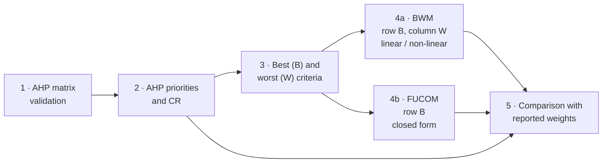

<h1 align="center">Deriving BWM and FUCOM Weights from AHP Pairwise Comparison Matrices</h1>

<p align="center">
  <a href="https://colab.research.google.com/drive/1dEuys0Bm5n13cdiKV5DtF6CPaH8hKXqG?usp=sharing"></a>
</p>

<p align="center">

  <em>Deriving BWM and FUCOM Weights from AHP Pairwise Comparison Matrices</em><br>
  [Authors] · Manuscript in preparation
</p>

---

## Table of contents

- [Overview](#overview)
- [Framework](#framework)
- [Main findings](#main-findings)
- [Quick start](#quick-start)
- [Repository structure](#repository-structure)
- [Published cases](#published-cases)
- [Reproducibility](#reproducibility)
- [References](#references)
- [Citation](#citation)
- [License](#license)

## Overview

Applied multi-criteria decision-making (MCDM) studies often report criteria weights from the **Analytic
Hierarchy Process (AHP)**, the **Best-Worst Method (BWM)** and the **Full Consistency Method (FUCOM)** for the
same problem, typically by asking the same experts to complete separate questionnaires. Yet the inputs of BWM
and FUCOM are subsets of a complete AHP pairwise comparison matrix: BWM uses the row of the best criterion and
the column of the worst criterion, and FUCOM can be fed with the comparisons of the best criterion with all
others.

This repository implements a framework that derives BWM and FUCOM weights directly from an existing AHP matrix
and evaluates the derivation analytically, on published data and by simulation. It enables analysts to

- obtain a **multi-method robustness check** from existing AHP data without additional elicitation,
- **locate inconsistency** in the judgements involving the best and worst criteria, and
- **re-analyse and audit** published AHP-based weightings.

## Framework



| Step | Description |
|---|---|
| 1 | Check positivity and reciprocity of the published matrix |
| 2 | Principal-eigenvector weights and consistency ratio (Saaty, 1990) |
| 3 | B = criterion with the largest AHP weight, W = criterion with the smallest |
| 4a | Best-to-Others = row B, Others-to-Worst = column W; linear (Rezaei, 2016) and non-linear (Rezaei, 2015) BWM |
| 4b | FUCOM ranking and comparative priorities from row B (Pamučar et al., 2018) |
| 5 | Pearson r, Spearman ρ, WS coefficient, MAE and maximum absolute deviation |

## Main findings

| Analysis | Result |
|---|---|
| Analytical properties | The extracted FUCOM model is always fully consistent (χ\* = 0) and reduces to the normalised reciprocals of the best-row entries. The extracted BWM model is fully consistent if and only if the best row and worst column satisfy multiplicative transitivity. |
| Seven published cases | Derived weights agree with separately elicited weights (BWM: mean r = 0.952; FUCOM: mean r = 0.976). Divergences are traced to different input judgements, the BWM model variant and the comparisons not used by the extracted models. |
| Monte Carlo simulation (18,000 matrices) | Reliable for AHP CR < 0.05 (median r ≥ 0.98 with the AHP weights), generally adequate up to 0.10, less reliable beyond. |
| Input-based consistency | Vectors extracted from acceptable AHP matrices (CR < 0.10) exceed the BWM thresholds of Liang et al. (2020) in 42.1% of cases. |

## Quick start

### Google Colab (no installation)

Open the notebook and select **Runtime → Run all**:

**[https://colab.research.google.com/drive/1dEuys0Bm5n13cdiKV5DtF6CPaH8hKXqG](https://colab.research.google.com/drive/1dEuys0Bm5n13cdiKV5DtF6CPaH8hKXqG?usp=sharing)**

The notebook in this repository can also be opened directly from GitHub:
[`run_in_colab.ipynb`](https://colab.research.google.com/github/karman09/ahp-bwm-fucom-derivation/blob/main/run_in_colab.ipynb).

### Local installation

Requires Python ≥ 3.10.

```bash
git clone https://github.com/karman09/ahp-bwm-fucom-derivation.git
cd ahp-bwm-fucom-derivation
pip install -r requirements.txt

python bwm_fucom_derivation.py      # published cases
python robustness_analyses.py       # robustness analyses and Monte Carlo simulation
```

## Repository structure

```text
ahp-bwm-fucom-derivation/
├── bwm_fucom_derivation.py   # MCDM_Extractor class, case data, agreement measures, Tables 1–5, A1–A8, B1–B7, Figs. 1–3
├── robustness_analyses.py    # Input-based CR, sensitivity to B and W, Monte Carlo simulation, Table 6, Table A9, Fig. 4
├── run_in_colab.ipynb        # Runs both scripts in Google Colab
├── requirements.txt          # numpy, scipy, pandas, matplotlib, openpyxl
├── LICENSE
└── README.md
```

**Outputs** (written to the working directory):

| File | Content |
|---|---|
| `BWM_FUCOM_Derivation_Report.xlsx` | Summary, manuscript tables and one sheet per case |
| `Robustness_Report.xlsx` | `InputCR`, `BW_Sensitivity`, `Simulation_Summary`, `Simulation_Raw`, `Simulation_Ties` |
| `Figure_1` – `Figure_3`, `figure_simulation` | Manuscript figures (SVG, PDF, PNG; TIFF for Figures 1–3) |
| `figure_case1.png` – `figure_case7.png` | Diagnostic figure for each case |

## Published cases

All matrices and reported weights were transcribed from the tables of the source studies and checked cell by
cell. Numbers in brackets refer to the [References](#references) below.

| Case | Application | n | Reported methods | Source tables | Source |
|:---:|---|:---:|---|---|:---:|
| 1 | Resource allocation in cloud computing | 8 | AHP, BWM, FUCOM | Tables 4, 6 (Example 3) | [1], [2] |
| 2 | Car purchase | 5 | AHP, BWM, FUCOM | Tables 7, 9 (Example 4) | [1], [3] |
| 3 | Smart-city components | 6 | AHP, BWM, FUCOM | Tables 8, 10, 13, 15 | [4] |
| 4 | Beekeeping land suitability, Mardin (Türkiye) | 9 | AHP, FUCOM | Tables 3, 4, 5 | [5] |
| 5 | Ranking of Libyan airlines | 5 | AHP, FUCOM | Tables 1, 2, 3 | [6] |
| 6 | Wind-farm site selection, Libya | 6 | AHP, BWM | Tables 2, 3, 4, 6 | [7] |
| 7 | Flash-flood susceptibility, Ibar basin (Montenegro) | 6 | AHP, BWM | Tables 6, 7 | [8] |

**Data notes**

- **Case 1.** The source prints a₂₃ = 4 and a₃₂ = 1/4, a transposition that yields CR = 0.105 and does not
  reproduce the reported AHP weights; the entries are used as a₂₃ = 1/4 and a₃₂ = 4.
- **Case 3.** The reported BWM and FUCOM weights are the arithmetic means of the three experts' weights.
- **Case 6.** The AHP matrix is the unweighted element-wise geometric mean of the four experts' matrices; the BWM
  weights are compared using the non-linear model stated in the source.

## Reproducibility

- The Monte Carlo simulation uses a fixed random seed (`SEED = 2026`); all values reported in the article are
  reproduced exactly.
- The simulation (6 × 6 × 500 = 18,000 matrices) takes a few minutes on a standard machine or in Colab.
- `robustness_analyses.py` imports the extractor and the case data from `bwm_fucom_derivation.py`; both files
  must be in the same folder.
- Linear programmes are solved with the HiGHS solver through `scipy.optimize.linprog`; the non-linear BWM is
  solved exactly by bisection on ξ.

## References

**Source studies**

1. Pamučar D, Stević Ž, Sremac S. A new model for determining weight coefficients of criteria in MCDM models: Full Consistency Method (FUCOM). *Symmetry* 2018;10(9):393. https://doi.org/10.3390/sym10090393
2. Ergu D, Kou G, Peng Y, Shi Y, Shi Y. The analytic hierarchy process: task scheduling and resource allocation in cloud computing environment. *The Journal of Supercomputing* 2013;64(3):835–48. https://doi.org/10.1007/s11227-011-0625-1
3. Rezaei J. Best-worst multi-criteria decision-making method: some properties and a linear model. *Omega* 2016;64:126–30. https://doi.org/10.1016/j.omega.2015.12.001
4. Ekin E, Sarul LS. Investigation of smart city components by AHP-BWM-FUCOM and DEMATEL methods. *Alphanumeric Journal* 2022;10(2):197–222. https://doi.org/10.17093/alphanumeric.1210018
5. Mercan Ç, Acıbuca V. Utilizing FUCOM and AHP methods to identify the optimal beekeeping lands: a case study from Mardin, Türkiye. *PLOS One* 2025;20(11):e0335784. https://doi.org/10.1371/journal.pone.0335784
6. Badi I, Abdulshahed A. Ranking the Libyan airlines by using Full Consistency Method (FUCOM) and Analytical Hierarchy Process (AHP). *Operational Research in Engineering Sciences: Theory and Applications* 2019;2(1):1–14. https://doi.org/10.31181/oresta1901001b
7. Badi I, Pamučar D, Stević Ž, Muhammad LJ. Wind farm site selection using BWM-AHP-MARCOS method: a case study of Libya. *Scientific African* 2023;19:e01511. https://doi.org/10.1016/j.sciaf.2022.e01511
8. Vujović F, Valjarević A, Durlević U, Morar C, Grama V, Spalević V, et al. A comparison of the AHP and BWM models for the flash flood susceptibility assessment: a case study of the Ibar River Basin in Montenegro. *Water* 2025;17(6):844. https://doi.org/10.3390/w17060844

**Methods**

9. Saaty TL. How to make a decision: the analytic hierarchy process. *European Journal of Operational Research* 1990;48(1):9–26. https://doi.org/10.1016/0377-2217(90)90057-I
10. Rezaei J. Best-worst multi-criteria decision-making method. *Omega* 2015;53:49–57. https://doi.org/10.1016/j.omega.2014.11.009
11. Liang F, Brunelli M, Rezaei J. Consistency issues in the best worst method: measurements and thresholds. *Omega* 2020;96:102175. https://doi.org/10.1016/j.omega.2019.102175
12. Sałabun W, Urbaniak K. A new coefficient of rankings similarity in decision-making problems. In: International Conference on Computational Science. Cham: Springer; 2020. p. 632–45. https://doi.org/10.1007/978-3-030-50417-5_47

## Citation

If you use this code, please cite the article and the archived software:

```bibtex
@unpublished{deriving_bwm_fucom_2026,
  title   = {Deriving {BWM} and {FUCOM} Weights from {AHP} Pairwise Comparison Matrices},
  author  = {[Authors]},
  year    = {2026},
  note    = {Manuscript in preparation}
}

@software{deriving_bwm_fucom_code_2026,
  title   = {Code for "Deriving BWM and FUCOM Weights from AHP Pairwise Comparison Matrices"},
  author  = {[Authors]},
  year    = {2026},
  version = {1.0},
  doi     = {10.5281/zenodo.<id>},
  url     = {https://github.com/karman09/ahp-bwm-fucom-derivation}
}
```

## License

Released under the [MIT License](LICENSE).
